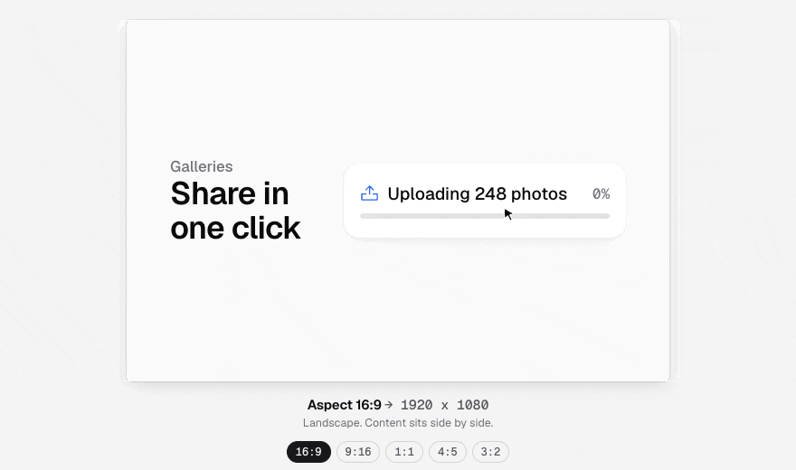
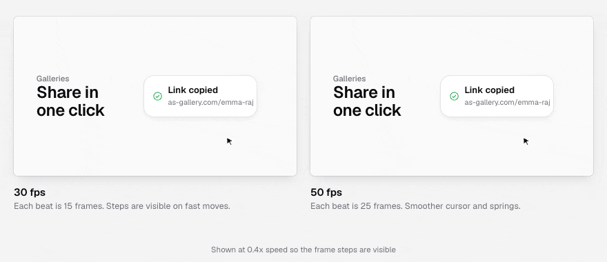
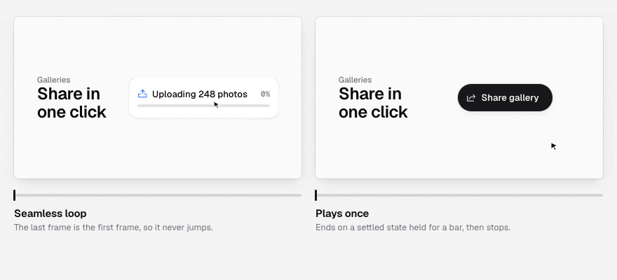
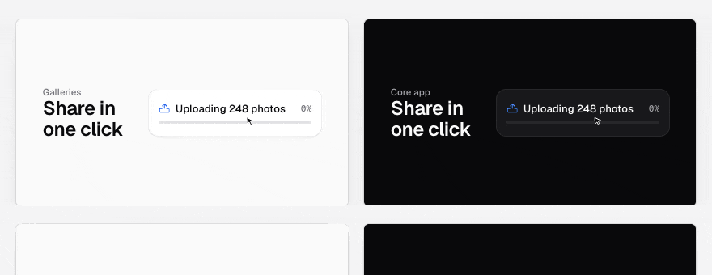

# Motion Video Brief

A responsive React (Vite + TypeScript) app to pick settings for a UI motion video and copy a ready-to-run prompt for Claude.

## Run

```bash
npm install
npm run dev      # http://localhost:5173
npm run build    # production build in dist/
```

## How the settings change the video

These clips are illustrations rendered in code, not real generated videos. They show what each setting asks Claude to do in the final output.

### Aspect ratio



The ratio sets the render size: the long side is 1920 px, and a square is 1440 x 1440. Landscape frames put content side by side. Portrait frames stack it and keep the cursor inside the centre 80% of the width. The minimum text height also scales with the short side, so the camera zooms in further on narrow frames. **Match reference** uses the reference video's own ratio.

### Frame rate



At 120 BPM a beat is 15 frames at 30 fps and 25 frames at 50 fps, so every beat lands on a whole frame either way. 50 fps gives a smoother cursor and smoother springs, but each frame gets fewer bits under a size cap. **Auto** picks the rate from the cap and format. GIF and WEBP stay at 30 unless the cap allows at least 1.5 MB per second, because every extra frame adds to the file size.

### Playback



**Seamless loop** makes the last frame match the first, so the springs and the cursor carry straight across the loop point. **Plays once** opens on the first state at rest, then ends on a settled final state held for at least one bar.

### Product



The product decides the theme tokens. Galleries uses light and the Core app uses dark. If the page loads in the other theme, Claude switches it before capture, so the sampled colours match.

### Render engine

**HyperFrames** is the default. It's HeyGen's open-source HTML-to-video renderer (Apache 2.0, free for commercial use). Projects like Core don't need it in their dependencies, because the prompt sets it up on its own:

- It checks for Node 22+, ffmpeg, and a `motion/package.json` with `hyperframes` pinned to an exact version. It installs only what is missing.
- Everything is installed in `motion/`, which goes in `.git/info/exclude`. The product's `package.json`, lockfile and CI stay untouched.
- It runs `npx hyperframes doctor` and a 1-second draft render first. If either fails, Claude stops and reports the error instead of carrying on.
- The scene is a HyperFrames composition driven by `registerFrameSource` calling the same pure `seek(t)`. Motion blur comes from `data-motion-blur`. MP4, WEBM and MOV render natively. GIF and WEBP render a PNG sequence that ffmpeg then encodes.

If the automatic setup fails on someone's machine, they can install HyperFrames by hand with the [Quickstart](https://hyperframes.heygen.com/quickstart) and fix common errors with [Troubleshooting](https://hyperframes.heygen.com/help). The tooltip next to Render engine links to both.

**Playwright + ffmpeg** is still available for a setup with no framework at all.

## Structure

- `src/lib/brief.ts`: the brief state, constants, and `buildBrief()`, a pure function that produces the prompt and derived values (canvas size, fps suggestion, bitrate)
- `src/lib/estimate.ts`: `estimateRun()`, a rough token estimate for one run of the brief (turns, output, total range) and the recommended model: Opus at Medium effort for videos, Sonnet at Medium (High when longer than 12 s or more than 4 steps) for GIF and WEBP
- `src/components/`: `SourceCard`, `OutputCard`, `SoundCard`, `BriefPanel`, `Header`, and shared UI primitives in `ui.tsx`
- `src/hooks/`: theme (light/dark, persisted), draft persistence (localStorage, credentials never saved), toast
- `src/index.css`: zinc design tokens with light/dark themes and responsive breakpoints at 960px and 560px
